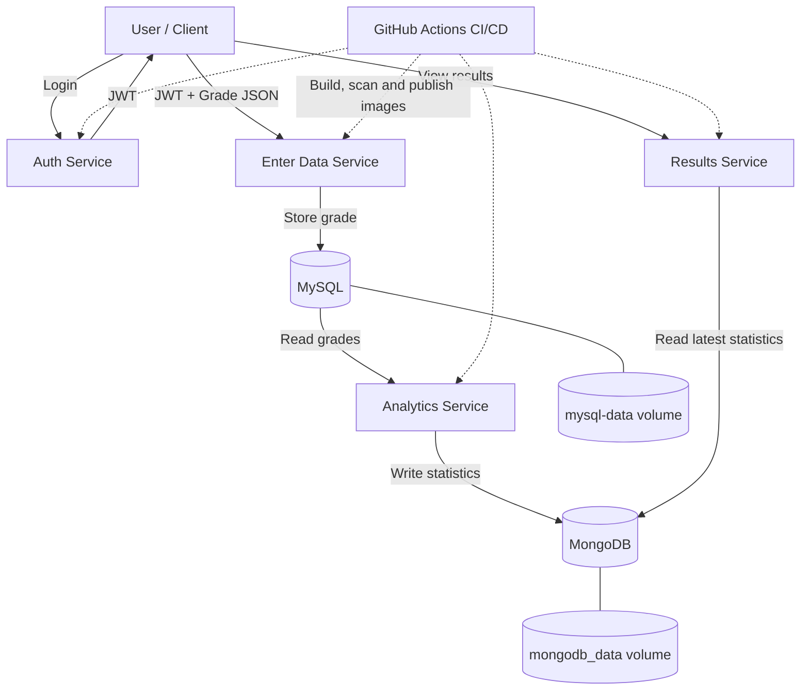

# ACIT3495---Project-I Student Grade Analytics

A containerized application for submitting student grades, authenticating users, calculating grade statistics, and displaying analytics.

## Architecture



- **Enter Data:** Flask web interface and API for login and grade submission.
- **Authentication:** Validates credentials and issues JWTs.
- **MySQL:** Stores submitted grades.
- **Analytics:** Calculates minimum, maximum, count, and average grade.
- **MongoDB:** Stores calculated statistics.
- **Results:** Serves the results dashboard and statistics API.

## Prerequisites

- Docker with Docker Compose
- Git

## Deployment

1. Clone the repository and enter its directory:

   ```bash
   git clone https://github.com/klintcholo/ACIT3495---Project-I.git 
   cd ACIT3495---Project-I
   ``` 

2. Create a `.env` file in the project root:

   ```dotenv
   MYSQL_ROOT_PASSWORD=<strong-mysql-password>
   MYSQL_PASSWORD=<strong-mysql-password>
   MONGO_ROOT_PASSWORD=<strong-mongodb-password>
   AUTH_USERNAME=<authentication-username>
   AUTH_PASSWORD=<strong-authentication-password>
   JWT_SECRET=<long-random-signing-secret>
   ```
  
 Use the same `JWT_SECRET` for both the Authentication and Enter Data services. Do not commit `.env` to Git.
   
   **Important:**
- Never commit `.env` or real credentials to Git.
- Keep `.env` in `.gitignore`.
- Do not place secrets directly in Dockerfiles, source code, or committed workflow files.
- Configure `DOCKERHUB_USERNAME` and `DOCKERHUB_TOKEN` as GitHub Actions repository secrets if your workflow uses Docker Hub publishing.
- Keep the environment-variable names consistent with `compose.yaml`.

## Deployment

Run the following commands from the project root.

### 1. Validate the configuration

```bash
docker compose config --quiet
```

If the command reports an error, check the Compose YAML and required environment variables before continuing.

### 2. Build and start the application

```bash
docker compose up -d --build
```

Docker Compose builds the service images and starts the containers in dependency order, using configured health checks where applicable.

### 3. Check service status

```bash
docker compose ps
```

Check that the services are running and that the configured health checks pass.

### 4. Inspect logs

```bash
docker compose logs --tail=50
```

To inspect a particular service:

```bash
docker compose logs --tail=50 auth-service
docker compose logs --tail=50 enter-data
docker compose logs --tail=50 analytics
docker compose logs --tail=50 results
```


## Access the application

| Component | URL |
|---|---|
| Enter Data webpage | http://localhost:5002 |
| Authentication service | http://localhost:5001 |
| Results dashboard | http://localhost:3001 |
| Statistics API | http://localhost:3001/api/statistics |

Log in through the Enter Data webpage and use the grade-entry interface to submit grades. The Enter Data service forwards login requests to the Authentication service and stores validated, authenticated submissions in MySQL.

The Analytics service periodically reads grades from MySQL and writes statistics to MongoDB. The Results service displays the latest available statistics.

## Verification

Check application health endpoints:

```bash
curl http://localhost:5001/health
curl http://localhost:5002/health
curl http://localhost:3001/health
```

Run the Analytics unit tests:

```bash
cd analytics
python -m unittest discover -s . -p 'test_*.py' -v
cd ..
```

Run the Results tests:

```bash
cd results
npm ci
npm test
cd ..
```

## Persistence and shutdown

The application uses named Docker volumes:

- `mysql-data` — persists submitted grade records.
- `mongodb_data` — persists calculated analytics statistics.

Ordinary container recreation does not intentionally delete these named volumes.

To stop the services while retaining the volumes:

```bash
docker compose down
```

To start them again:

```bash
docker compose up -d
```

**Warning:** The following command removes the Compose-managed volumes and their stored data:

```bash
docker compose down -v
```

Do not use it when you need to preserve grade records or analytics results.

## CI/CD

GitHub Actions automates application checks, tests, Docker image builds, vulnerability scanning, and image publishing. The publishing workflow is configured for `linux/amd64` and `linux/arm64`; successful workflow runs and published image manifests provide evidence that both architectures are supported.
